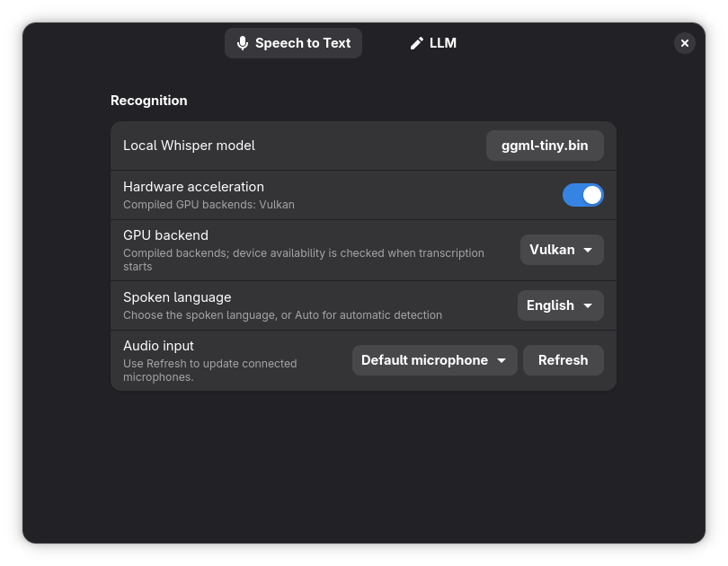
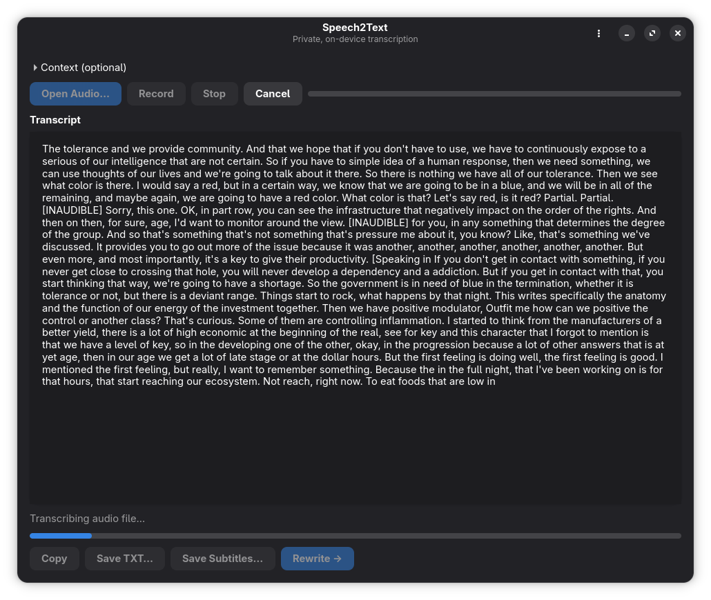
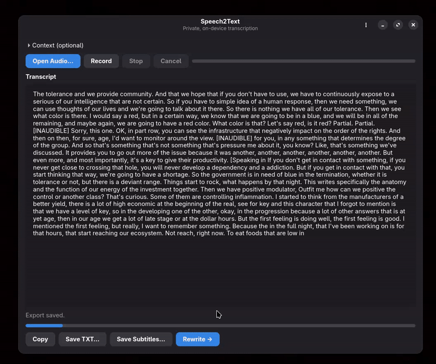
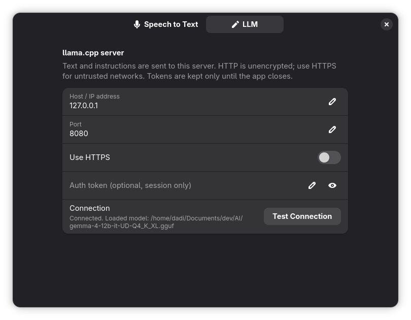
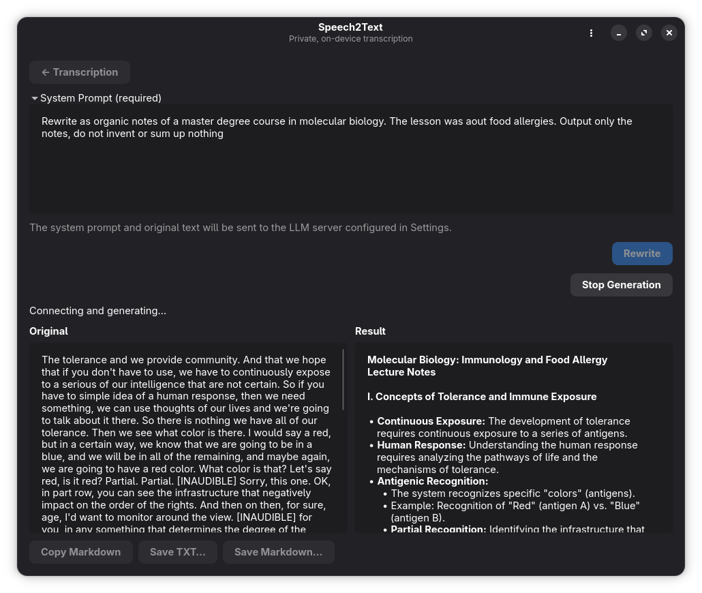

# Speech2Text

Speech2Text is a local-first desktop application for turning audio files and microphone recordings into text. It uses Whisper for on-device recognition and offers optional transcript rewriting through a separately configured llama.cpp server.

The interface is built with GTK 4 and libadwaita. Linux and Windows packages support CPU and Vulkan inference; models are downloaded separately. Project code is [MIT-licensed](LICENSE); dependencies retain their [own licenses](LICENSES.txt).

Software debeloped by **Davide Camino**.

## Features

- **Audio files:** queue one or more WAV, MP3, FLAC, OGG/Vorbis, or M4A (AAC/ALAC) files, reorder them with drag-and-drop or buttons, and transcribe sequentially with current-file progress and total time remaining.
- **Microphone:** choose an input, monitor recording duration and level, and see live provisional text alongside finalized text.
- **Recognition settings:** automatic language detection, supported Whisper language codes, and optional recognition context for names or specialist vocabulary.
- **Model library:** download multilingual Tiny, Base, Small, Medium, or Large V3 with SHA-256 verification; use or copy an existing local model. Downloads and copies support cancellation.
- **Editable transcripts:** correct text after recognition stops, copy it, export TXT or original timed SRT subtitles, and replace or append subsequent transcriptions.
- **Hardware acceleration:** CPU mode or a compiled GPU backend. Source builds can enable Vulkan, CUDA, Metal, or Linux ROCm.
- **LLM rewriting:** stream results from a configured server, stop generation while keeping partial output, and copy/export Markdown or plain text.
- **Desktop controls:** keyboard shortcuts, Ctrl + mouse-wheel text zoom, saved preferences, and warnings before discarding unexported text.

## Usage

### 1. Select a model and recognition settings

Open **⋮ → Settings → Speech to Text → Local Whisper model**. Choose **Download…** for a catalog model, or **Select Local Model…** to use an existing whisper.cpp `.bin` model. External models can be used in place or copied into the application's model folder. Tiny is a useful starting point for live recognition; larger models need more memory and processing time.

Choose the spoken language, **Auto**, or **Custom…** for another supported Whisper language code. Enable hardware acceleration if your build and GPU support it, or disable it for CPU inference. **Automatic** uses Whisper's default GPU selection.



### 2. Transcribe a file or microphone

Choose **Open Audio…** to select one or more files without starting transcription. An expandable queue appears below the controls and **Record** changes to **Start**. Expand the queue to reorder files by dragging a row or using its up/down buttons, or remove individual files. Opening audio again replaces the pending queue. Queue editing is disabled while processing.

Click **Start** when ready; if a transcript already exists, choose **Replace** or **Append** once for the entire batch. Files run sequentially in queue order, with a blank line between files that produce text. Subtitle timestamps continue along the original subtitle timeline.

The progress bar shows the current file's progress. Beside it, **File 2 of 5 · 12 min remaining** shows the current position and time remaining for the current file plus all pending files. Time remaining also appears for a single file. It is calculated from audio durations and observed processing speed; **Calculating time remaining…** appears until enough information is available, or when a pending file's duration cannot be determined.

**Cancel** clears the queue and stops the current file without starting the next. Finalized text is kept, unfinished provisional text is removed when the worker finishes, and source audio is never deleted or modified. A file error keeps completed text and continues with the next file. If a PCM WAV ends before its declared length, the app transcribes the readable portion. One popup at the end of the batch lists the incomplete files and any other failures. Completing or cancelling the batch returns to microphone mode. Queued files are not saved in recovery snapshots and do not resume automatically.

To record from a microphone, select an **Audio input** in Settings and click **Record** with no audio file selected. Use **Refresh** after connecting or disconnecting a microphone. Optionally expand **Context (optional)** and enter names or vocabulary before starting; this guides recognition rather than acting as an instruction to rewrite the result.

Grey text is provisional and may change. **Stop** ends microphone capture and finishes buffered audio. **Cancel** discards unfinished work but keeps finalized text; model loading must finish before cancellation can complete.

When a transcript already exists, choose **Replace** to start over or **Append** to preserve it and add the new recognition.



### 3. Edit and export

The main transcript is editable whenever transcription is stopped. **Copy**, **Save TXT**, and **Rewrite** use the current text, including your corrections.

**Save Subtitles** exports the original recognized text and timestamps as SRT—not your manual text edits. Appending preserves edited text, while subtitle timings continue from the original subtitle timeline.

Export anything you want to keep permanently. When closing with unexported text or active work, choose **Cancel**, **Close Without Saving**, or **Autosave & Close**. Autosave & Close writes a temporary recovery snapshot in the app's data folder, then exits. On the next launch, the transcript (including manual edits and original subtitle timings), rewrite source/instructions, and partial rewrite result are restored; unexported content remains marked unsaved. The recovery file is deleted only after successful restoration. Recording and generation never resume automatically.

If autosaving fails, the app stays open and offers retry or closing without saving. On startup, unreadable recovery files are moved into a unique `recovery-unreadable-*` backup folder in the app's data directory, and the app shows the backup path. If it cannot move the file, a new autosave will not overwrite it. This is explicit save-on-close recovery, **not periodic autosaving or crash recovery**. Ctrl + mouse wheel changes text size without changing exported content; zoom lasts for the current session.



### 4. Rewrite with an LLM (optional)

Run a separate llama.cpp server with a chat-capable GGUF model, for example:

```sh
llama-server -m /path/to/model.gguf --host 127.0.0.1 --port 8080
```

For a server offering multiple models without automatic loading, you can instead run:

```sh
llama serve --no-models-autoload -ngl 20 --models-dir ~/Documents/dev/AI
```

In **Settings → LLM**, enter the hostname/IP and the port printed by your server, optionally supply an authentication token, and select **Refresh Models** (or **Test Connection**). Choose a **Model** and **Reasoning level** from the dropdowns, then click **Apply**. Settings closes and the selected model loads in the background. Wait for **Model ready** before clicking Rewrite. Model discovery does not load models, and Rewrite no longer initiates model loading. The app does not launch the server, unload other models, or change its GPU-layer settings.

Reasoning choices are **Server default**, **Off**, **Low**, **Medium**, and **High**. Server default sends no override; other choices use the server's `reasoning_effort` parameter. Support depends on the model's chat template and server version: unsupported levels may be ignored or rejected. Model and reasoning selections are saved locally. Refresh again after changing servers or adding/removing models; unavailable saved selections must be reselected.

Enter a hostname, not a full URL. HTTPS requires a server or reverse proxy with a trusted certificate.



Open **Rewrite**, expand **System Prompt (required)**, enter your instructions, and start generation. The current transcript is sent as the original text. **Stop Generation** keeps partial output. **Copy Markdown** and Markdown export preserve the raw response; TXT export removes Markdown formatting.

The renderer supports headings, emphasis, lists, quotations, and code. Links are inert; images show alt text. No generated content automatically opens files or fetches images.



### Privacy and saved data

- Whisper recognition runs locally. Audio is processed in memory, not saved by the app.
- Explicit model downloads contact Hugging Face and its download servers.
- LLM tests and rewrites contact the configured server; rewriting sends instructions and transcript text, **not audio**. Use loopback for a local HTTP server or HTTPS on untrusted networks.
- Authentication tokens are session-only. Recognition context, rewrite instructions, and other preferences are saved locally as **unencrypted JSON**; do not put secrets in saved prompts.
- **Autosave & Close** explicitly stores transcript text, original subtitles, rewrite source/instructions/output, and recognition context as **unencrypted JSON** in `recovery.json` in the app's data folder. Audio and authentication tokens are not included. Recovery files are limited to 64 MiB.
- Exports are written only to the location you select. See [installation and data locations](INSTALL.md#saved-data) for settings, models, and the recovery file.

## Installation

- **[Install Speech2Text](INSTALL.md):** Linux Flatpak and Windows installer instructions, updates, and saved-data locations.
- **[Build from source](BUILD_FROM_SOURCE.md):** prerequisites, CPU/GPU builds, tests, and local Flatpak/Windows packaging.

## Missing features and current limitations

- No periodic autosaving, crash recovery, transcript history, audio saving, translation, speaker diarization, or batch-file queue. Save-on-close recovery requires explicitly choosing Autosave & Close.
- No model-download resume or automatic microphone hot-plug monitoring.
- Live recognition is chunk-based, not instantaneous. Slow inference can overflow the capture queue; use a smaller model or supported GPU. Silence can still produce hallucinated text.
- Subtitle timings are approximate. Dedicated voice-activity detection, professional alignment, and subtitle editing are not implemented.
- No individual GPU picker or reporting of the device actually used internally; the native engine may fall back to CPU.
- LLM models are managed by the external server; the app only lists, selects, and loads them. There is no conversation history or splitting of transcripts that exceed the model's context window. Output is limited to 512 KiB.
- Markdown tables, syntax highlighting, and image rendering are not implemented.
- No automatic application updates, Flathub publication, or macOS installer. Windows installers are unsigned. GPU, microphone, and clean-machine compatibility require platform-specific testing.
