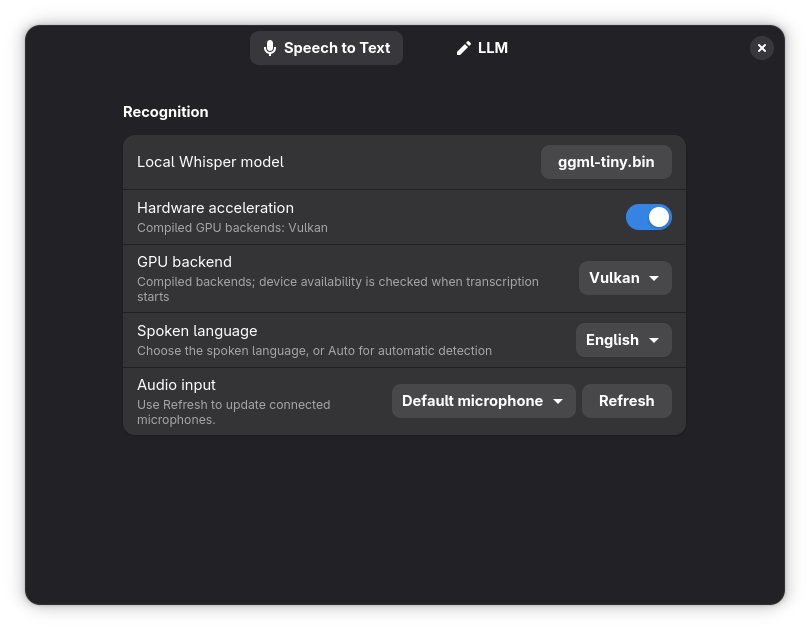
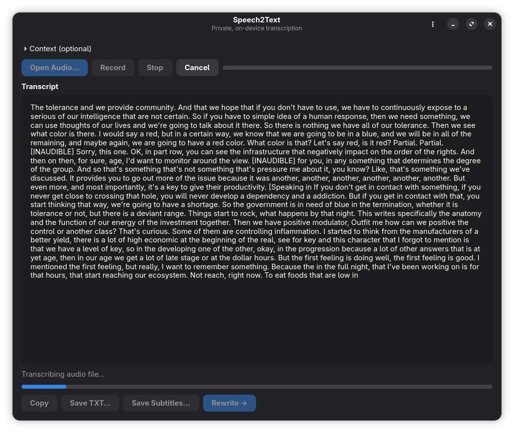
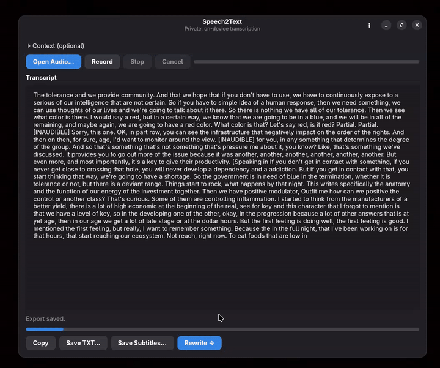
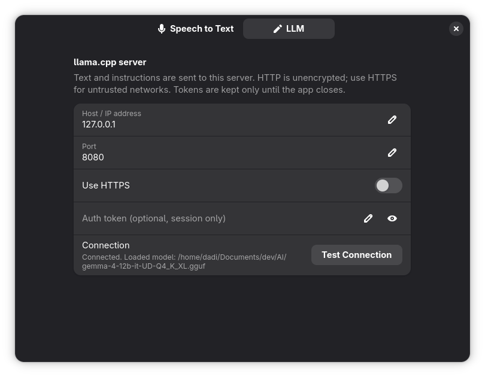
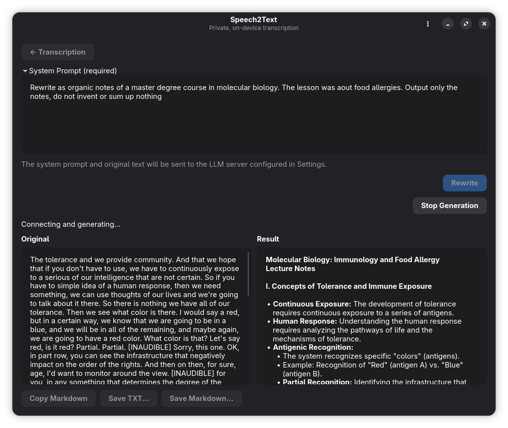

# Speech2Text

Speech2Text is a local-first desktop application for turning audio files and microphone recordings into text. It uses Whisper for on-device recognition and offers optional transcript rewriting through a separately configured llama.cpp server.

The interface is built with GTK 4 and libadwaita. Linux and Windows packages support CPU and Vulkan inference; models are downloaded separately. Project code is [MIT-licensed](LICENSE); dependencies retain their [own licenses](LICENSES.txt).

Software debeloped by **Davide Camino**.

## Features

- **Audio files:** transcribe WAV, MP3, FLAC, OGG/Vorbis, and M4A (AAC/ALAC).
- **Microphone:** choose an input, monitor recording duration and level, and see live provisional text alongside finalized text.
- **Recognition settings:** automatic language detection, supported Whisper language codes, and optional recognition context for names or specialist vocabulary.
- **Model library:** download multilingual Tiny, Base, Small, Medium, or Large V3 with SHA-256 verification; use or copy an existing local model. Downloads and copies support cancellation.
- **Editable transcripts:** correct text after recognition stops, copy it, export TXT or original timed SRT subtitles, and replace or append subsequent transcriptions.
- **Hardware acceleration:** CPU mode or a compiled GPU backend. Source builds can enable Vulkan, CUDA, Metal, or Linux ROCm.
- **LLM rewriting:** stream results from a configured server, stop generation while keeping partial output, and copy/export Markdown or plain text.
- **Desktop controls:** keyboard shortcuts, Ctrl + mouse-wheel text zoom, saved preferences, and warnings before discarding unexported text.

## Usage

### 1. Select a model and recognition settings

Open **⋮ → Settings → Speech to Text → Local Whisper model**. Choose **Download…** for a catalog model, or **Select Local Model…** to use an existing whisper.cpp `.bin` model. External models can be used in place or copied into the application's model folder. Tiny is a useful starting point for live recognition; larger models need more memory and processing time.

Choose the spoken language, **Auto**, or **Custom…** for another supported Whisper language code. Enable hardware acceleration if your build and GPU support it, or disable it for CPU inference. **Automatic** uses Whisper's default GPU selection.



### 2. Transcribe a file or microphone

Open an audio file, or select an **Audio input** in Settings and start recording. Use **Refresh** after connecting or disconnecting a microphone. Optionally expand **Context (optional)** and enter names or vocabulary before starting; this guides recognition rather than acting as an instruction to rewrite the result.

Grey text is provisional and may change. **Stop** ends microphone capture and finishes buffered audio. **Cancel** discards unfinished work but keeps finalized text; model loading must finish before cancellation can complete.

When a transcript already exists, choose **Replace** to start over or **Append** to preserve it and add the new recognition.



### 3. Edit and export

The main transcript is editable whenever transcription is stopped. **Copy**, **Save TXT**, and **Rewrite** use the current text, including your corrections.

**Save Subtitles** exports the original recognized text and timestamps as SRT—not your manual text edits. Appending preserves edited text, while subtitle timings continue from the original subtitle timeline.

Export anything you want to keep: transcripts and rewrite results are **not saved automatically**. Ctrl + mouse wheel changes text size without changing exported content; zoom lasts for the current session.



### 4. Rewrite with an LLM (optional)

Run a separate llama.cpp server with a chat-capable GGUF model, for example:

```sh
llama-server -m /path/to/model.gguf --host 127.0.0.1 --port 8080
```

In **Settings → LLM**, enter the hostname/IP and port, optionally supply an authentication token, and select **Test Connection**. Enter a hostname, not a full URL. HTTPS requires a server or reverse proxy with a trusted certificate.



Open **Rewrite**, expand **System Prompt (required)**, enter your instructions, and start generation. The current transcript is sent as the original text. **Stop Generation** keeps partial output. **Copy Markdown** and Markdown export preserve the raw response; TXT export removes Markdown formatting.

The renderer supports headings, emphasis, lists, quotations, and code. Links are inert; images show alt text. No generated content automatically opens files or fetches images.



### Privacy and saved data

- Whisper recognition runs locally. Audio is processed in memory, not saved by the app.
- Explicit model downloads contact Hugging Face and its download servers.
- LLM tests and rewrites contact the configured server; rewriting sends instructions and transcript text, **not audio**. Use loopback for a local HTTP server or HTTPS on untrusted networks.
- Authentication tokens are session-only. Recognition context, rewrite instructions, and other preferences are saved locally as **unencrypted JSON**; do not put secrets in saved prompts.
- Exports are written only to the location you select. See [installation and data locations](INSTALL.md#saved-data) for settings and model folders.

## Installation

- **[Install Speech2Text](INSTALL.md):** Linux Flatpak and Windows installer instructions, updates, and saved-data locations.
- **[Build from source](BUILD_FROM_SOURCE.md):** prerequisites, CPU/GPU builds, tests, and local Flatpak/Windows packaging.

## Missing features and current limitations

- No transcript autosave/history, audio saving, translation, speaker diarization, or batch-file queue.
- No model-download resume or automatic microphone hot-plug monitoring.
- Live recognition is chunk-based, not instantaneous. Slow inference can overflow the capture queue; use a smaller model or supported GPU. Silence can still produce hallucinated text.
- Subtitle timings are approximate. Dedicated voice-activity detection, professional alignment, and subtitle editing are not implemented.
- No individual GPU picker or reporting of the device actually used internally; the native engine may fall back to CPU.
- LLM rewriting uses the first model advertised by the server. There is no model management, conversation history, or splitting of transcripts that exceed its context window. Output is limited to 512 KiB.
- Markdown tables, syntax highlighting, and image rendering are not implemented.
- No automatic application updates, Flathub publication, or macOS installer. Windows installers are unsigned. GPU, microphone, and clean-machine compatibility require platform-specific testing.
